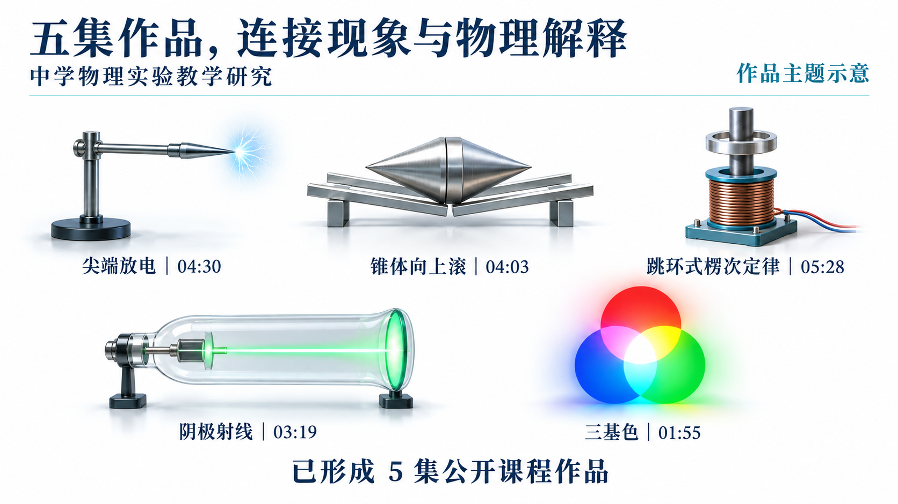
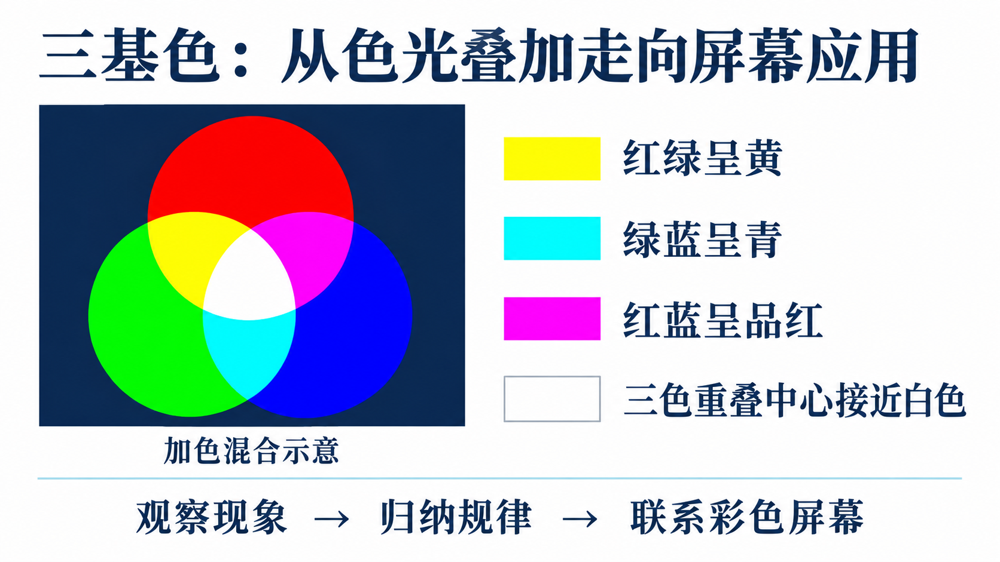
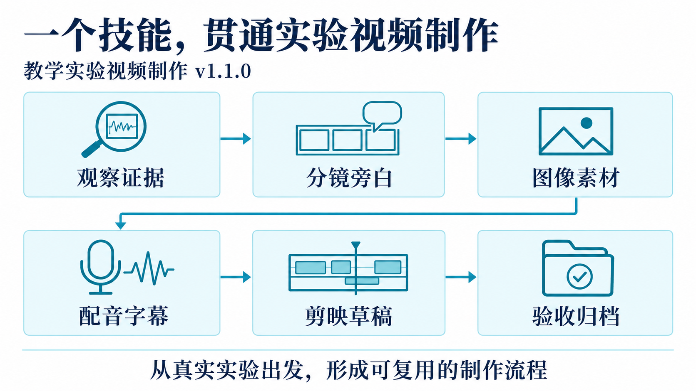
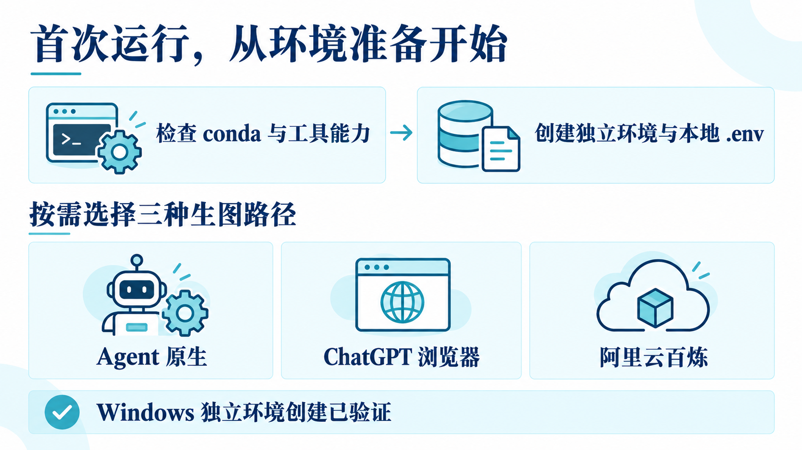
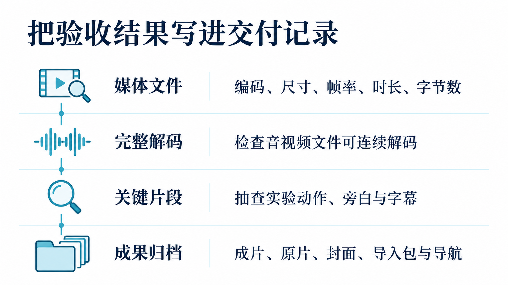

# 教学实验视频制作 · Teaching Experiment Video

**从一段真实实验录像出发，把观察、解释和剪辑组织成清楚的教学故事。**

[](https://github.com/HNNUYUXUAN/teaching-experiment-video/actions/workflows/tests.yml) · **Skill 1.1.0** · [MIT License](LICENSE)


<table>
<tr><th>5 集课程作品</th><th>6 个制作环节</th><th>3 条生图路径</th><th>1 个技能入口</th></tr>
<tr><td align="center">力学 · 电磁学 · 光学</td><td align="center">观察证据到验收归档</td><td align="center">Agent · 浏览器 · 百炼</td><td align="center"><a href="SKILL.md">读取 SKILL.md 开始</a></td></tr>
</table>

一只闭合金属环跃起，带切口的环留在底部；三束色光相遇，交叠区域出现新的颜色。实验的吸引力就在这些值得停下来观察的瞬间。本项目把制作这些课堂视频时反复使用的方法，整理为一个自包含的 Agent Skill：核对原片、设计分镜、生成插图、制作配音与字幕、编排剪映草稿，再检查和归档成片。

[观看五集课程作品](https://www.douyin.com/collection/7691177993527363599/1) · [立即开始](#从一段录像开始) · [技能入口](SKILL.md) · [首次运行](references/first-run.md) · [图片生成](references/images.md) · [验证记录](docs/validation.md)

## 五集作品，一条教学主线

这套流程来自「中学物理实验教学研究」合集的实际制作。每一集围绕一个观察问题展开，再把现象接到物理解释与生活应用。



| 作品 | 时长 | 观察入口 |
|---|---:|---|
| 尖端放电 | 04:30 | 从放电现象联系避雷针 |
| 锥体向上滚 | 04:03 | 从看似向上的运动讨论重心变化 |
| 跳环式楞次定律 | 05:28 | 比较闭合环与切口环，保留连续原速观察 |
| 阴极射线 | 03:19 | 观察电子束，进入带电粒子运动 |
| 三基色 | 01:55 | 观察加色混合，联系彩色屏幕 |

作品信息核对于 2026-10-25；公开合集的后续更新以链接页面为准。上图用于介绍作品主题，原始实验画面见视频。

<details>
<summary><strong>展开教学案例：三基色——先让学生看见，再一起解释</strong></summary>

红光与绿光叠加呈黄，绿光与蓝光叠加呈青，红光与蓝光叠加呈品红，三者重叠的中心接近白色。视频先给足观察时间，再用结构清楚的图示帮助归纳，最后联系屏幕中的 RGB。



生成的图像承担解释任务；原片承担现象证据。两者在分镜中有各自的角色。

</details>

## 一个技能，贯通制作流程



技能把每个阶段的输入、输出、验收条件和恢复动作写清楚。项目用 `state.json` 记录进度，换一次会话或换一个具备相应能力的 Agent，也能沿着已有证据和产物继续工作。

| 带来什么 | 制作中逐步形成什么 | 最后带走什么 |
|---|---|---|
| 实验录像、教学目标、参考素材 | 证据表、分镜旁白、图像、连续音轨、时间戳字幕 | 可编辑草稿、成片、导入包、封面与交付记录 |

<details>
<summary><strong>展开各环节操作指南</strong></summary>

| 环节 | 帮助你完成什么 | 入口 |
|---|---|---|
| 首次启动 | 检查 conda，建立独立 Python 环境，创建本机 `.env` | [首次运行](references/first-run.md) |
| 跨 Agent 接手 | 核实文件、终端、浏览器和图像工具能力 | [能力适配](references/agent-adapter.md) |
| 图片制作 | Agent 原生、ChatGPT 浏览器、百炼三条路径 | [图片生成](references/images.md) |
| 配音字幕 | 连续音轨、实际时长、字词时间戳与单行字幕 | [音频流程](references/audio.md) |
| 剪辑交付 | 草稿副本、编解码核验、媒体检查与归档 | [草稿操作](references/draft.md) · [交付结构](references/delivery.md) |

</details>

## 从一段录像开始

### ① 取得技能

| 下载入口 | 用途 |
|---|---|
| [GitHub 技能包](https://github.com/HNNUYUXUAN/teaching-experiment-video/releases/download/v1.1.0/teaching-experiment-video-1.1.0.zip) | 直接使用；版本信息位于宿主兼容的 `metadata.version` |
| [联想原始上传包](https://github.com/HNNUYUXUAN/teaching-experiment-video/releases/download/v1.1.0/teaching-experiment-video-1.1.0-lenovo-original.zip) | 与联想开放平台 1.1.0 上传文件逐字节一致 |
| [源码仓库](https://github.com/HNNUYUXUAN/teaching-experiment-video) | 阅读、贡献和继续维护 |

制作脚本、资源和指引与联想提交版保持一致。平台上传记录为 **2026-10-25，1.1.0，待审核**。原包 SHA-256、元数据适配范围和自动核对方法见[版本一致性说明](docs/release-parity.md)。

### ② 准备环境与生图路径



<details open>
<summary><strong>Windows：复制这组命令开始预检</strong></summary>

```powershell
git clone https://github.com/HNNUYUXUAN/teaching-experiment-video.git
cd teaching-experiment-video
& ./scripts/bootstrap.ps1 -CheckOnly
& ./scripts/bootstrap.ps1
& ./scripts/run.ps1 -Script doctor
```

已有 Anaconda 或 Miniconda 时，bootstrap 会复用 conda 并为本技能建立独立环境。需要安装 Miniconda 时，先阅读提示并接受官方适用条款，再按照[首次运行指南](references/first-run.md)执行安装参数。Windows 使用当前用户安装，运行目录与技能目录分别管理。

</details>

<details>
<summary><strong>Linux / Apple Silicon macOS：查看命令与适配范围</strong></summary>

在技能目录运行：

```bash
bash scripts/bootstrap.sh --check-only
bash scripts/bootstrap.sh
bash scripts/run.sh doctor
```

平台实现和实测范围见[首次运行](references/first-run.md)、[兼容性](references/compatibility.md)与[验证记录](docs/validation.md)。

</details>

### ③ 把第一段录像交给 Agent

把仓库目录放到你的 Agent 支持的技能目录，或让它直接读取 `SKILL.md`。可以这样开始：

> 请使用 teaching-experiment-video 处理我指定文件夹中的实验录像。先完成环境预检与录像证据表，围绕一个适合课堂的问题设计分镜和旁白。图片使用我当前已连接的浏览器中的 ChatGPT；每完成一个阶段，请核验产物并更新 state.json。

Agent 会根据实际工具和账号条件推进工作。你可以先完成原片整理、分镜和提示词，再补齐所需的云端配置。

### 选择适合自己的图片路径

| 路径 | 准备条件 | 运行方式 |
|---|---|---|
| Agent 原生生图 | 当前 Agent 提供图像工具 | 按宿主工具说明生成并保存原图 |
| Chrome / Edge 中的 ChatGPT | 浏览器已连接，账号已登录且可用 | 通过页面创建图像并下载原图 |
| 阿里云百炼 | 本机 Key、匹配的地域与模型权限 | 先 dry-run，再按授权执行 API 请求 |

需要百炼时，在 bootstrap 创建的本机 `.env` 中填写 `DASHSCOPE_API_KEY`，并确认 `BAILIAN_REGION`。Key 由你在本机保存；API 地址与 Key 的含义和填写位置见[配置指南](references/configuration.md)。

## 怎样确认这次制作完成了



| 图像 | 声音与字幕 | 草稿与成片 |
|---|---|---|
| 逐字核对、物理关系、颜色和箭头 | 实际 WAV 时长、字词时间戳、连续试听 | 目标剪映版本核验、编辑器播放、完整解码和关键片段抽查 |

`checks/` 保存验证记录，`delivery/` 保存可交付成果。文件结构与检查字段见[制作执行表](references/execution.md)、[制作验收](references/workflow.md)和[交付结构](references/delivery.md)。

本版为 **1.1.0**。Windows x64 的已有 conda 建环境路径已进行本机验证，17 项制作行为测试通过；仓库 CI 同时检查与联想发布基准的一致性。其他平台、真实云请求和每个剪映安装版本分别按[验证记录](docs/validation.md)确认。

## 继续完善这套方法

欢迎带着具体实验、分镜建议或可复现的问题交流。提交 Issue 时，可以说明操作系统、Agent、当前阶段、预期结果和已脱敏的错误摘要；贡献脚本时，附上能复现行为的测试和对应指南更新。

目录导航：[`SKILL.md`](SKILL.md) · [`scripts/`](scripts/) · [`references/`](references/) · [`assets/`](assets/) · [`llms.txt`](llms.txt)

## 作者与使用许可

**缪雨轩**，淮南师范学院 2024 级物理学（师范）专业学生。喜欢探索 AI 应用、物理教学仿真与数据分析，也参与科研和教学实践。很高兴认识您，希望以后多交流、多向您学习！

[个人主页](https://www.yuxuan.wiki/) · [GitHub](https://github.com/HNNUYUXUAN) · [Gitee](https://gitee.com/hnnuxuan) · [ORCID](https://orcid.org/0009-0007-3369-452X)

原创代码与技能文档采用 [MIT License](LICENSE)。第三方草稿编解码源码遵循其 Apache-2.0 许可；README 插图的生成来源、视频作品链接和第三方材料说明见[素材与许可](docs/assets-and-licenses.md)。引用项目可使用 [`CITATION.cff`](CITATION.cff)。
